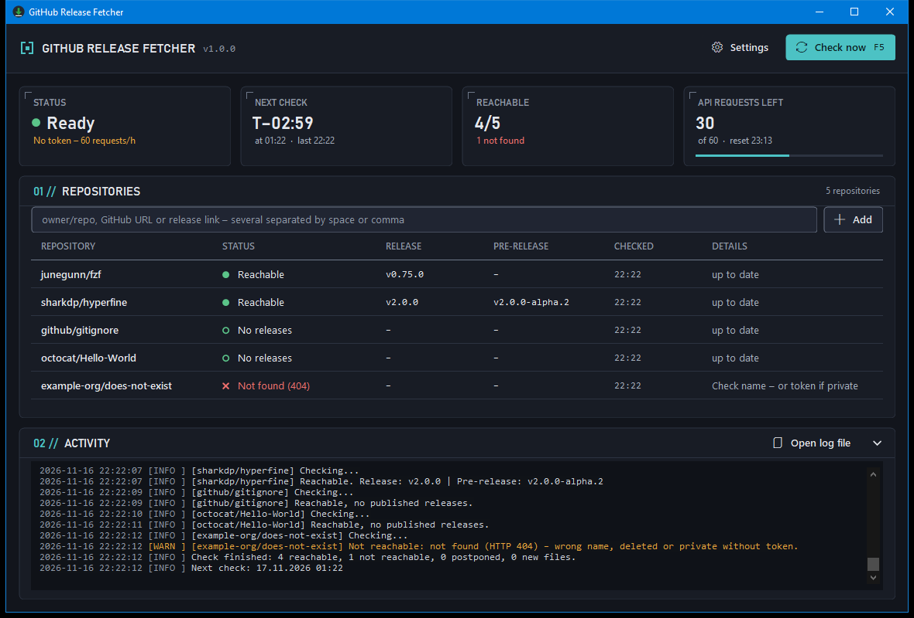
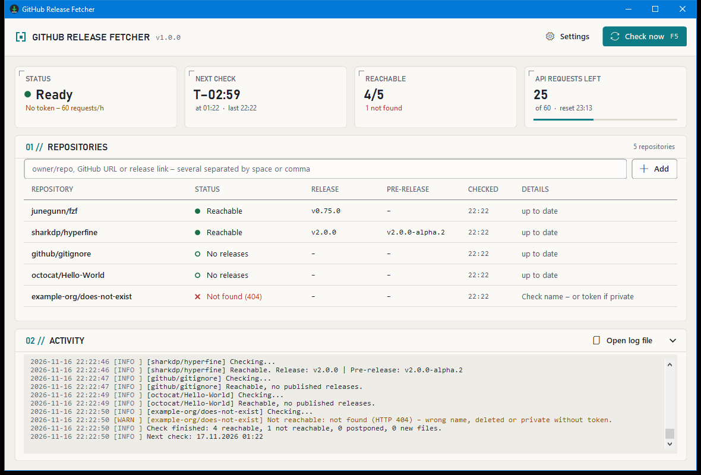
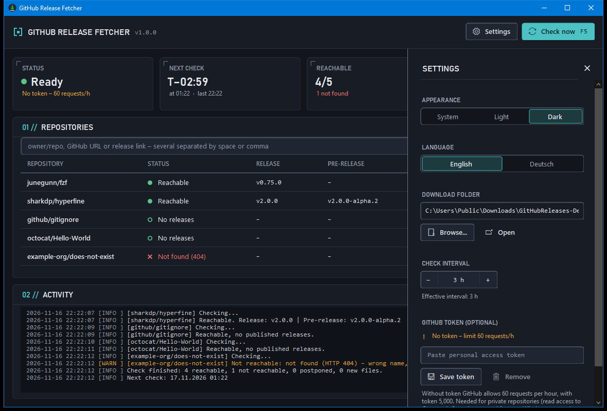

# GitHub Release Fetcher

**[English](#english) | [Deutsch](#deutsch)**

---

## English

A small Windows tray tool (C# / .NET 8 WinForms) that automatically downloads the **latest release** and the **latest pre-release** of any number of GitHub repositories, including all **assets** and the **source code** (`.zip` and `.tar.gz`).



| Light | Settings |
|---|---|
|  |  |

### Features

- Graphical user interface in a calm "instrument panel" style, **light / dark / follow Windows** (high contrast is respected), language switchable between **English** and **German**
- Four status tiles: state, countdown to the next check, reachable repositories, remaining API requests
- Minimizing or closing the window (X) sends the app to the **system tray**; exiting is **only possible via the tray menu**
- Tray right-click menu with status information (state, last/next check, reachable repositories, remaining API requests), "Check now" and "Exit"
- Selectable **download folder** (stored persistently)
- Repository input accepts:
  - `owner/repo`
  - `https://github.com/owner/repo` (also without `https://`, with `www.` or `.git`)
  - release page links like `https://github.com/owner/repo/releases` or `.../releases/tag/v1.2.3`
  - several entries at once (separated by space, comma, semicolon or new line)
- **Repository table** with status, latest release / pre-release, last check and details; sortable, multi-select
  - Remove with **Del** or the context menu (with confirmation; downloaded files are kept)
  - Context menu / double-click: open releases on GitHub, open the repository's download folder, copy the name
- Status shows the **cause** when a repository is not reachable: *Not found (404)*, *Token invalid (401)*, *Access denied (403)*, *Network error* – with a short hint what to do. An unreachable repository never causes an error, the remaining ones are processed normally
- Selectable **check interval in hours** (default: 3 h)
- Optional **GitHub token** (stored encrypted with Windows DPAPI, only readable by your Windows user)
- Collapsible **activity console** (warnings and errors colored) and inline notices instead of message boxes
- Keyboard: **F5** check now, **Esc** close settings, **Del** remove selected, **Enter** add repository / save token
- **Log file with timestamps** covering the last month (older entries are removed automatically), openable via button
- **Repositories without any release** are saved as dated **snapshots**: the default branch is downloaded as a ZIP. A new snapshot is only made when the repository changed (new commit), and only the **3 newest snapshots** are kept
- Already downloaded files are skipped; release files are **never deleted** (only old snapshots beyond the newest 3 are removed)

### Folder structure

```
<Download folder>\
└── owner_repo\
    ├── Releases\
    │   └── v1.2.3\
    │       ├── asset-file.exe
    │       ├── repo-v1.2.3-source.zip
    │       └── repo-v1.2.3-source.tar.gz
    ├── Pre-Releases\
    │   └── v1.3.0-beta1\
    │       └── ...
    └── Snapshots\                         (only for repositories without a release)
        ├── 2026-11-20_08-15_3f2a9c1\
        │   └── repo-2026-11-20-3f2a9c1.zip
        └── 2026-11-24_07-55_9b8e4d0\
            └── repo-2026-11-24-9b8e4d0.zip
```

Every new release gets its own subfolder, old release folders are kept. Folder names are always English (independent of the UI language).

**Snapshots** are named `<date>_<time>_<commit>` (local time of the download, short commit ID). At each check the newest commit of the default branch is compared with the newest snapshot; only if it differs, a new snapshot folder is created. Older snapshots beyond the newest 3 are removed automatically – other folders you put into `Snapshots\` are never touched. As soon as the repository publishes a release, the normal release download takes over and the existing snapshots are kept.

### GitHub API limit / check interval

GitHub allows **60 API requests per hour per IP address** without a token and **5,000 per hour** with a personal access token (see [GitHub Docs – Rate limits for the REST API](https://docs.github.com/en/rest/using-the-rest-api/rate-limits-for-the-rest-api)).

Each check needs 1 request per repository (repositories without a release: 2), plus 2 requests (source code zip/tar.gz) only when a new release has to be downloaded, or 1 request for a new snapshot. To stay safely below the limit, the tool:

- uses only ~80 % of the budget and **raises the effective interval automatically** if the selected interval is too short for the number of repositories (shown in the GUI),
- waits 1.5 s between repositories,
- reads GitHub's rate limit headers and stops **before** the limit is reached,
- on HTTP 403/429 (limit reached) postpones the remaining repositories until the reset time given by GitHub.

With the default of 3 h and no token, more than 100 repositories can be checked safely.

### GitHub token (optional)

Recommended for many repositories or for private repositories.
Create one at *GitHub → Settings → Developer settings → Personal access tokens*.
For public repositories no permissions are needed; for private repositories read access to *Contents* is required (fine-grained token).
After clicking "Save token" the token is validated once.

### Storage locations

| What | Where |
|---|---|
| Settings (folder, repositories, interval, language, theme, encrypted token) | `%APPDATA%\GitHubReleaseFetcher\settings.json` |
| Log (last 31 days) | `%APPDATA%\GitHubReleaseFetcher\log.txt` |

### Build

Requirements: Windows, [.NET 8 SDK](https://dotnet.microsoft.com/download/dotnet/8.0) or newer

```bat
build.bat
```

or manually:

```bat
dotnet publish GitHubReleaseFetcher.csproj -c Release -r win-x64 --self-contained true -p:PublishSingleFile=true -p:IncludeNativeLibrariesForSelfExtract=true -o publish
```

Result: `publish\GitHubReleaseFetcher.exe` – a single file that runs without an installed .NET runtime.

### Notes

- Only one instance can run at a time.
- Draft releases are ignored.
- "Latest" = most recently published release (or pre-release) according to the GitHub API.
- If an existing file differs in size from the GitHub version, the old file is kept as `*.old-<timestamp>` and the new one is downloaded.
- Incomplete downloads (`*.part`) are discarded and retried at the next check.

---

## Deutsch

Ein kleines Windows-Tray-Tool (C# / .NET 8 WinForms), das automatisch den **neuesten Release** und den **neuesten Pre-Release** beliebig vieler GitHub-Repositories herunterlädt – inklusive aller **Assets** und des **Quellcodes** (`.zip` und `.tar.gz`).

Screenshots: siehe [oben](#english) bzw. [`docs/screenshots`](docs/screenshots).

### Funktionen

- Grafische Oberfläche im ruhigen „Instrumententafel“-Stil, **Hell / Dunkel / wie Windows** (hoher Kontrast wird berücksichtigt), Sprache umschaltbar zwischen **Englisch** und **Deutsch**
- Vier Statuskacheln: Zustand, Countdown bis zur nächsten Prüfung, erreichbare Repositories, verbleibende API-Anfragen
- Minimieren oder Schließen (X) schickt das Programm in den **Infobereich (Tray)**; Beenden ist **nur über das Tray-Menü** möglich
- Rechtsklick-Menü am Tray-Symbol mit Statusinformationen (Zustand, letzte/nächste Prüfung, erreichbare Repositories, verbleibende API-Anfragen), „Jetzt prüfen“ und „Beenden“
- Auswählbarer **Download-Ordner** (wird dauerhaft gespeichert)
- Repository-Eingabe akzeptiert:
  - `owner/repo`
  - `https://github.com/owner/repo` (auch ohne `https://`, mit `www.` oder `.git`)
  - Release-Seiten-Links wie `https://github.com/owner/repo/releases` oder `.../releases/tag/v1.2.3`
  - mehrere Einträge auf einmal (getrennt durch Leerzeichen, Komma, Semikolon oder Zeilenumbruch)
- **Repository-Tabelle** mit Status, neuestem Release / Pre-Release, letzter Prüfung und Details; sortierbar, Mehrfachauswahl
  - Entfernen mit **Entf** oder über das Kontextmenü (mit Bestätigung; heruntergeladene Dateien bleiben erhalten)
  - Kontextmenü / Doppelklick: Releases auf GitHub öffnen, Download-Ordner des Repositorys öffnen, Namen kopieren
- Der Status nennt die **Ursache**, wenn ein Repository nicht erreichbar ist: *Nicht gefunden (404)*, *Token ungültig (401)*, *Zugriff verweigert (403)*, *Netzwerkfehler* – mit kurzem Hinweis, was zu tun ist. Ein nicht erreichbares Repository verursacht nie einen Fehler, die übrigen werden normal verarbeitet
- Einstellbares **Prüfintervall in Stunden** (Standard: 3 h)
- Optionaler **GitHub-Token** (verschlüsselt per Windows-DPAPI gespeichert, nur für deinen Windows-Benutzer lesbar)
- Einklappbare **Aktivitäts-Konsole** (Warnungen und Fehler farbig) und Hinweise direkt im Fenster statt Meldungsfenstern
- Tastatur: **F5** jetzt prüfen, **Esc** Einstellungen schließen, **Entf** Auswahl entfernen, **Enter** Repository hinzufügen / Token speichern
- **Log-Datei mit Zeitstempeln** über den letzten Monat (ältere Einträge werden automatisch entfernt), per Button zu öffnen
- **Repositories ohne Release** werden als **Snapshots mit Datum** gesichert: Der Standard-Branch wird als ZIP heruntergeladen. Ein neuer Snapshot entsteht nur, wenn sich das Repository geändert hat (neuer Commit), und es bleiben nur die **3 neuesten Snapshots** erhalten
- Bereits heruntergeladene Dateien werden übersprungen; Release-Dateien werden **nie gelöscht** (entfernt werden nur alte Snapshots über die neuesten 3 hinaus)

### Ordnerstruktur

```
<Download-Ordner>\
└── owner_repo\
    ├── Releases\
    │   └── v1.2.3\
    │       ├── asset-datei.exe
    │       ├── repo-v1.2.3-source.zip
    │       └── repo-v1.2.3-source.tar.gz
    ├── Pre-Releases\
    │   └── v1.3.0-beta1\
    │       └── ...
    └── Snapshots\                         (nur bei Repositories ohne Release)
        ├── 2026-11-20_08-15_3f2a9c1\
        │   └── repo-2026-11-20-3f2a9c1.zip
        └── 2026-11-24_07-55_9b8e4d0\
            └── repo-2026-11-24-9b8e4d0.zip
```

Jeder neue Release bekommt einen eigenen Unterordner, alte Release-Ordner bleiben erhalten. Die Ordnernamen sind immer englisch (unabhängig von der Oberflächensprache).

**Snapshots** heißen `<Datum>_<Uhrzeit>_<Commit>` (Ortszeit des Downloads, kurze Commit-ID). Bei jeder Prüfung wird der neueste Commit des Standard-Branches mit dem neuesten Snapshot verglichen; nur wenn er abweicht, entsteht ein neuer Snapshot-Ordner. Ältere Snapshots über die neuesten 3 hinaus werden automatisch entfernt – andere Ordner, die du selbst in `Snapshots\` ablegst, werden nie angefasst. Sobald das Repository einen Release veröffentlicht, übernimmt der normale Release-Download; die vorhandenen Snapshots bleiben erhalten.

### GitHub-API-Limit / Prüfintervall

GitHub erlaubt ohne Token **60 API-Anfragen pro Stunde und IP-Adresse**, mit persönlichem Access-Token **5.000 pro Stunde** (siehe [GitHub Docs – Rate limits for the REST API](https://docs.github.com/en/rest/using-the-rest-api/rate-limits-for-the-rest-api)).

Jede Prüfung braucht 1 Anfrage pro Repository (Repositories ohne Release: 2), plus 2 Anfragen (Quellcode zip/tar.gz) nur dann, wenn ein neuer Release heruntergeladen werden muss, bzw. 1 Anfrage für einen neuen Snapshot. Um sicher unter dem Limit zu bleiben:

- nutzt das Tool nur ca. 80 % des Kontingents und **erhöht das effektive Intervall automatisch**, wenn das gewählte Intervall für die Anzahl der Repositories zu kurz ist (wird in der GUI angezeigt),
- wartet 1,5 s zwischen den Repositories,
- liest die Rate-Limit-Header von GitHub aus und stoppt **bevor** das Limit erreicht ist,
- verschiebt bei HTTP 403/429 (Limit erreicht) die restlichen Repositories bis zur von GitHub genannten Freigabezeit.

Mit dem Standard von 3 h und ohne Token können über 100 Repositories sicher geprüft werden.

### GitHub-Token (optional)

Empfohlen bei vielen Repositories oder für private Repositories.
Erstellen unter *GitHub → Settings → Developer settings → Personal access tokens*.
Für öffentliche Repositories sind keine Berechtigungen nötig; für private Repositories wird Lesezugriff auf *Contents* benötigt (Fine-grained Token).
Nach „Token speichern“ wird der Token einmalig geprüft.

### Speicherorte

| Was | Wo |
|---|---|
| Einstellungen (Ordner, Repositories, Intervall, Sprache, Erscheinungsbild, verschlüsselter Token) | `%APPDATA%\GitHubReleaseFetcher\settings.json` |
| Log (letzte 31 Tage) | `%APPDATA%\GitHubReleaseFetcher\log.txt` |

### Bauen

Voraussetzungen: Windows, [.NET 8 SDK](https://dotnet.microsoft.com/download/dotnet/8.0) oder neuer

```bat
build.bat
```

oder manuell:

```bat
dotnet publish GitHubReleaseFetcher.csproj -c Release -r win-x64 --self-contained true -p:PublishSingleFile=true -p:IncludeNativeLibrariesForSelfExtract=true -o publish
```

Ergebnis: `publish\GitHubReleaseFetcher.exe` – eine einzelne Datei, die ohne installierte .NET-Runtime läuft.

### Hinweise

- Es kann immer nur eine Instanz laufen.
- Entwurfs-Releases (Drafts) werden ignoriert.
- „Neuester“ = zuletzt veröffentlichter Release (bzw. Pre-Release) laut GitHub-API.
- Weicht eine vorhandene Datei in der Größe von der GitHub-Version ab, wird die alte als `*.old-<Zeitstempel>` behalten und die neue heruntergeladen.
- Unvollständige Downloads (`*.part`) werden verworfen und bei der nächsten Prüfung erneut versucht.
