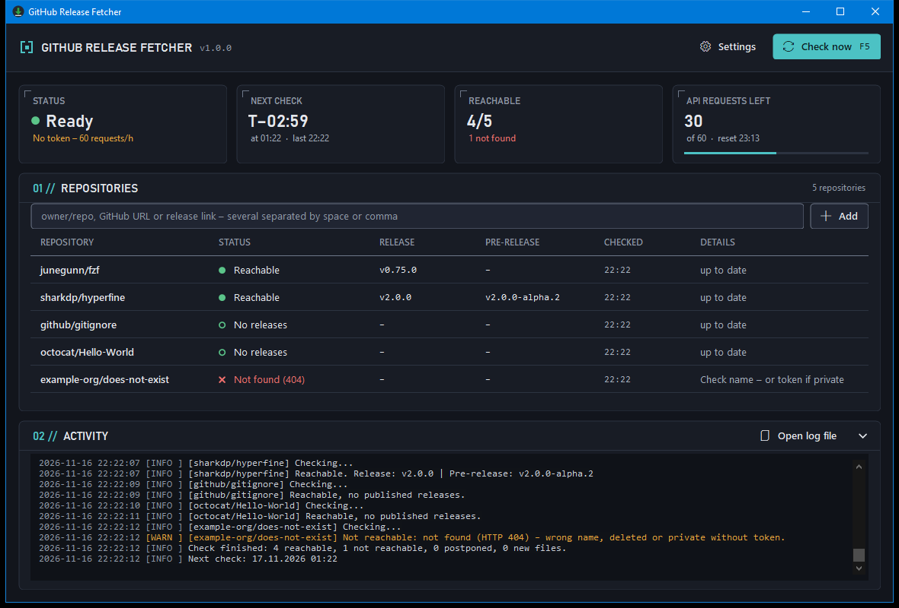

# Design-Council – UI-Redesign „Retro-Futuristic“

Dieses Dokument hält den gesamten Redesign-Prozess nachvollziehbar fest:
- wer bewertet,
- was gefordert wurde,
- was umgesetzt ist,
- welche Bewertungen vergeben wurden.

> **Status:** Abgeschlossen am 16.11.2026. Nach drei Bewertungsrunden unter echtem Windows vergeben alle vier Council-Mitglieder **8/10**. Damit ist das Abbruchkriterium (alle ≥ 8/10) erreicht.

| Runde | Opus 5.5 | Sonnet 5.5 | Haiku 5.5 | Fable 5.2 |
|---|---|---|---|---|
| 0 – altes UI | 3 | 3 | 4 | 4 |
| 1 – Entwurf v1 unter Windows | 7 | 7 | 6 | 7 |
| 2 – nach Umsetzung von Runde 1 | **8** | **8** | **8** | 7 |
| 3 – nach Umsetzung von Runde 2 | – | – | – | **8** |

---

## 1. Zusammensetzung des Councils

Der Council besteht ausschließlich aus Claude-Modellen. Jedes Mitglied hat eine eigene Rolle.

| Mitglied | Rolle |
|---|---|
| Opus 5.5 | Visual Design & Retro-Futurismus (Palette, Typografie, Konsistenz, Hierarchie) |
| Sonnet 5.5 | UX & Informationsarchitektur (Klarheit, Vereinfachung, Abläufe) |
| Haiku 5.5 | Erstnutzer-Sicht, Lesbarkeit & Augenschonung (WCAG-Kontrast, Status nie nur über Farbe) |
| Fable 5.2 | WinForms-Umsetzung & technische Qualität (Theming, DPI, Fallstricke) |

**Abbruchkriterium:** Alle vier vergeben ≥ 8/10 für die Designqualität.

---

## 2. Runde 0 – Ausgangslage (altes UI)

| Mitglied | Bewertung | Kernaussage |
|---|---|---|
| Opus 5.5 | **3/10** | Kein visuelles System, hart codierte Farben, umgekehrte Hierarchie, Courier-Log |
| Sonnet 5.5 | **3/10** | Formular-Stapel: Einstellungen oben, Tabelle unten; doppelte Repo-Ansicht; unlesbare Statuszeile |
| Haiku 5.5 | **4/10** | Kein Dark Mode, DarkOrange-Warntext nur ca. 2,3:1 Kontrast, Status nur über Zeilenfarbe |
| Fable 5.2 | **4/10** | Layout solide, aber keine Theme-Architektur, unskalierte Pixelwerte, nicht themebare Controls |

### Gemeinsame Anforderungen aus Runde 0

**Informationsarchitektur (Sonnet)**
- Kopfleiste mit „Jetzt prüfen“ als einziger gefüllter Hauptaktion und einem Zahnrad für die Einstellungen.
- Vier Kennzahlen-Kacheln statt der „|“-Statuszeile.
- Repo-Tabelle als Hauptfläche, Hinzufügen direkt darüber, Fehler inline statt MessageBox.
- Separates Repo-Listen-Fenster entfällt. Entfernen direkt in der Tabelle (Entf, Kontextmenü, Bestätigung).
- Einstellungen in einem Seitenpanel. Aktivitäts-Log unten, einklappbar.
- Fortschritt der Prüfung sichtbar. Tray-Verhalten unverändert.
- Keine Funktion darf verloren gehen. Alle Texte DE und EN.

**Visual Design (Opus)**
- Zentrale Farb-Tokens.
  - Dunkel: kühles Graphit, z. B. `#12151C`, `#181C25`, `#E4E7EC`.
  - Hell: warmes Papier, z. B. `#F2F0EB`, `#FAF9F6`, `#1C2028`.
- Genau eine Akzentfarbe „Signal-Petrol“ (Dunkel `#4CC2C4`, Hell `#0E7C86`), getrennt von den Statusfarben.
- Schriften:
  - Segoe UI für den Text,
  - Bahnschrift (nur für Titel und Kennzahlen, in Versalien),
  - Cascadia Mono bzw. Consolas für Log, Tags und Zeiten.
- Retro-Futurismus als „Instrumententafel“:
  - Countdown `T–hh:mm`,
  - 2-px-Signallinie als Fortschrittsbalken,
  - Eckmarken nur an einer Stelle.
- Verboten:
  - Scanlines, Neon-Glow, Pixel- oder Orbitron-Schriften,
  - reines Schwarz oder Weiß,
  - mehr als eine Akzentfarbe,
  - ein „halber“ Dark Mode.

**Lesbarkeit (Haiku)**
- WCAG AA (Text ≥ 4,5:1, Rahmen ≥ 3:1) in beiden Modi.
- Status immer als Symbol und Text, nie nur über Farbe.
- Ursache sichtbar machen statt nur „nicht erreichbar“.
- Keine Animationen, kein Blinken. Mindestschriftgröße 9 pt.

**Technik (Fable)**
- Eigenes Theme-System, weil es in .NET 8 kein `SetColorMode` gibt.
- Erkennung über `AppsUseLightTheme` und Reaktion auf `WM_SETTINGCHANGE` („ImmersiveColorSet“). Hoher Kontrast nutzt die Systemfarben.
- Dunkle Titelleiste per `DwmSetWindowAttribute` (20/19, unter Windows 11 zusätzlich 34/35/36).
- Dunkle Scrollbars per `SetWindowTheme("DarkMode_Explorer")`.
- Eigene Controls statt GroupBox, Button, ComboBox und NumericUpDown.
- DataGridView statt ListView. Themed ToolStrip-Renderer.
- Alle Pixelwerte DPI-skaliert. Kein `WS_EX_COMPOSITED`. MessageBox und FolderBrowserDialog bleiben System.

---

## 3. Entwurf v1 – umgesetzt (Cloud-Sitzung)

| Datei | Inhalt |
|---|---|
| `Theme.cs` | Paletten Dark/Light/HighContrast, Modus System/Hell/Dunkel, Systemerkennung, Schriftwahl mit Fallbacks, Titelleiste und Scrollbars (native), flackerfreies Umschalten |
| `UiControls.cs` | `FlatButton` (Primary/Secondary/Ghost), `InputBox` mit Platzhalter, `SegmentedControl`, `Stepper`, `CardPanel`, `HeaderBar` mit Signal-/Fortschrittslinie, `StatTile` und `TilesPanel` (4 Spalten oder 2×2), `ThemedGrid` (Statussymbol + Text, Auswahl-Akzentbalken, Leerzustand), `NoticeLine`, `ThemedMenuRenderer`, `ThemedDialog` |
| `MainForm.cs` | Neuer Aufbau (siehe unten); Prüf-, Rate-Limit- und Tray-Logik unverändert übernommen |
| `AppSettings.cs` | Neue Einstellungen `Theme` (`system`/`light`/`dark`) und `LogExpanded` |
| `Lang.cs` | Neue Texte DE/EN für Kacheln, Einstellungen, Hinweise, Leerzustand |
| `RepoListForm.cs` | **entfernt**; Funktion jetzt in der Haupttabelle |

**Aufbau des Hauptfensters**
1. **Kopfleiste:** Logo-Klammer, Titel in Versalien und Version. Rechts „Einstellungen“ (Ghost) und „Jetzt prüfen F5“ (Primary). Unten eine Linie, die während der Prüfung als 2-px-Fortschritt läuft.
2. **Kacheln:** STATUS, NÄCHSTE PRÜFUNG (Countdown `T–hh:mm`), ERREICHBAR (x/y mit Ursache), API-ANFRAGEN ÜBRIG (Messbalken, Reset-Zeit).
3. **01 // Repositories:** Eingabe mit Platzhalter, „Hinzufügen“, Inline-Hinweiszeile; Tabelle mit Repository, Status (Form-Symbol + Text), Release, Pre-Release, Geprüft, Details. Sortierbar, Mehrfachauswahl.
4. **02 // Aktivität:** Einklappbar (Klick auf die Kopfzeile oder den Pfeil). Eingeklappt sieht man die letzte Logzeile, aufgeklappt eine Konsole mit WARN/ERROR in den Statusfarben.
5. **Einstellungen:** Overlay-Panel von rechts (Esc schließt) mit Erscheinungsbild, Sprache, Download-Ordner, Prüfintervall, GitHub-Token und Tray-Hinweis.

**Statussymbole (formunterscheidbar, auch ohne Farbe):**

| Status | Symbol |
|---|---|
| Erreichbar | ● gefüllter Kreis |
| Keine Releases | ○ Ring |
| Nicht gefunden / Token ungültig / Zugriff verweigert / Netzwerkfehler | ✕ |
| API-Limit | ‖ Pause |
| Prüft | Ring mit Punkt (neutral) |
| Wartet | gepunkteter Ring |

---

## 4. Prüfung unter Windows (16.11.2026)

Umgebung: Windows 10 22H2 (19045), 100 % DPI, „Akzentfarbe auf Titelleisten“ aktiv, .NET 10 SDK (baut das `net8.0-windows`-Projekt).

- **Build:** `dotnet publish` (wie `build.bat`) fehlerfrei und ohne Warnungen.
- **Download-Fix HTTP 415:** live bestätigt. Alle Quellcode-Archive (`…-source.zip/.tar.gz`) werden geladen.
- **Schriften:** Bahnschrift, Cascadia Mono und Segoe-MDL2-Symbole werden erkannt.
- **Funktionen getestet:**
  - Repos hinzufügen: mehrere auf einmal und als URL; Duplikate und ungültige Einträge werden inline gemeldet.
  - Entfernen per Entf und per Kontextmenü, jeweils mit Bestätigung.
  - Prüfen per Button, F5 und automatisch nach Zeitplan.
  - Log ein- und ausklappen.
  - Theme System/Hell/Dunkel und Sprache.
  - Esc schließt die Einstellungen.
  - Leerzustand und Mindestgröße 900×620.
- **Unter Windows gefundene und behobene Fehler (vor Runde 1):**
  - Theme-Auswahl zeigte keine Markierung, weil `SelectedIndex` vor `Items` gesetzt wurde.
  - Im Dunkelmodus blieben die Scrollbars von Einstellungs-Panel und Tabelle hell. Die DataGridView-internen Scrollbars bekommen ihr Handle erst nach `OnHandleCreated`.
  - Im Kontextmenü klebte das Tastenkürzel am Text, weil Layout-Schrift und Zeichen-Schrift verschieden waren. Außerdem stand dort „Del“ statt „Entf“.
  - Die Spalte „Letzte Prüfung“ war abgeschnitten (jetzt „Geprüft“).
  - Im Dialog stand der Plural „Repository/Repositories“.
  - Bei Mindestgröße verdeckte das Log die Tabelle.
- **Nicht testbar:** 125/150 % DPI und Hoher Kontrast (Systemeinstellungen nicht änderbar) sowie das Tray-Menü (kein Zugriff auf die Taskleiste). Den API-Limit-Zustand kann man nicht gezielt herbeiführen. Diese Punkte sind per Code-Review abgesichert.

---

## 5. Runde 1 – Entwurf v1 unter Windows

| Mitglied | Bewertung | Zwingend für ≥ 8 |
|---|---|---|
| Opus 5.5 | **7/10** | Hierarchie (drei Ebenen in derselben Caption-Schrift), Eckmarken an acht Stellen, Akzent als Statusfarbe, Akzent-Stummel in der Signallinie, reines Weiß im Hellmodus |
| Sonnet 5.5 | **7/10** | Getrennte Fehlerursachen statt „Nicht erreichbar“, Details-Spalte abgeschnitten, Tooltips für Symbol-Buttons |
| Haiku 5.5 | **6/10** | Rahmen < 3:1 (1,7:1), „F5“-Hinweis ca. 3,1–3,9:1, TextMuted < 4,5:1 auf Bg/Console, Hell-Warn/Ok im Log < 4,5:1, Ursache nicht sichtbar |
| Fable 5.2 | **7/10** | Geisterfenster (WM_SETREDRAW setzt WS_VISIBLE beim Theme-Wechsel im Tray), Shift+Tab-Falle in jeder InputBox, Hochkontrast-Auswahltext, fehlende Accessible-Namen |

### Umsetzung nach Runde 1

**Visual Design**
- Neue Tokens `Theme.SectionTitle` (Bahnschrift SemiBold 11 pt, `Text`) und `Theme.ColumnHeader` (Segoe UI Semibold 9 pt). Kachel-Labels und Spaltenköpfe in `TextMuted`.
- Eine einzige Eckmarke oben links, immer `LineStrong`.
- Prüfzustand neutral, das ungenutzte Token `Info` ist entfernt. Petrol nur für Aktionen und Marke, 2-px-Fortschritt und Messbalken.
- Signallinie im Leerlauf 1 px `Line`.
- Hell: `Raised` `#FDFCFA`, `OnAccent` `#FAF9F6`.
- Tabelle: Repo-Namen in Semibold, Tags und Zeiten in Mono 9 pt.
- Bestätigungsdialog: neue `ButtonKind.Danger` (Error-Outline); „Abbrechen“ bleibt Standard.
- Einstellungs-Panel mit kräftigerer Kante und Titel in Versalien.

**UX**
- `FailReason` in `ReleaseChecker`: Status „Nicht gefunden (404)“, „Token ungültig (401)“, „Zugriff verweigert (403)“, „Netzwerkfehler“. Die Kachel zeigt die Ursache, z. B. „1 nicht gefunden“.
- In „Details“ steht eine kurze Handlungsanweisung; die technische Meldung steht im Tooltip und im Log.
- Tooltips für alle Symbol-Buttons. Die Kopfzeile „02 // Aktivität“ ist klickbar.
- Neue Zeilenaktionen per Kontextmenü: „Releases auf GitHub öffnen“, „Download-Ordner öffnen“, „Namen kopieren“. Doppelklick öffnet die Releases-Seite.
- Der Tray-Tooltip zeigt x/y erreichbar.
- Bei Mindestgröße bleiben mindestens drei Tabellenzeilen sichtbar.

**Lesbarkeit** (alle Werte nachgerechnet)

| Token | Dunkel | Hell |
|---|---|---|
| `LineStrong` | `#6E788A` (3,8:1) | `#80858F` (3,5:1) |
| `TextMuted` | `#8E97A6` (≥ 5,2:1) | `#5F6672` (≥ 4,9:1) |
| `Warn` | – | `#8F5300` (≥ 5,2:1) |
| `Ok` | – | `#1A7046` (≥ 5,2:1) |

Zusätzlich ist der „F5“-Hinweis jetzt deckend (7,97:1 bzw. 4,70:1).

**Technik**
- WM_SETREDRAW nur bei sichtbarem Fenster.
- `InputBox` ist selbst nicht mehr fokussierbar, Shift+Tab funktioniert wieder.
- Hochkontrast: `SelectionText` überall, wo ausgewählte Elemente Text zeigen. `SystemEvents.UserPreferenceChanged` löst ein Neuzeichnen im aktuellen Theme aus.
- Windows-10-Titelleiste wird per WM_NCACTIVATE neu gezeichnet.
- Accessible-Namen und Rollen für SegmentedControl, Stepper und StatTile. Home/End funktionieren; das Mausrad am Stepper ist entfernt.
- Tray-Icon in echter Kleinsymbolgröße.
- `ApplicationConfiguration.Initialize()` läuft vor der Meldung „läuft bereits“.
- Fenster-Zustand (z. B. maximiert) bleibt beim Wiederherstellen aus dem Tray erhalten.

---

## 6. Runde 2

| Mitglied | Bewertung | Kernaussage |
|---|---|---|
| Opus 5.5 | **8/10** | Alle Regelverstöße behoben, Hierarchie trägt. Rest ist typografischer Feinschliff (Kennzahlen-Schreibweise, Gedankenstriche, Dialog-Überschrift). |
| Sonnet 5.5 | **8/10** | Fehlerursachen, Handlungsanweisungen, Tooltips und Zeilenaktionen erfüllt. Für 9: Spalten bei Mindestgröße, Panel ohne Scrollen, Tray-Marker. |
| Haiku 5.5 | **8/10** | Alle Kontrastforderungen bestanden (nachgerechnet). Empfohlen: Hell-Rahmen mit mehr Puffer, Danger-Hover heller. |
| Fable 5.2 | **7/10** | Fixes korrekt. Neu: `ObjectDisposedException` beim Shutdown (Tray-Icon vor NotifyIcon freigegeben), Log-Konsole mit heller Scrollbar. |

### Umsetzung nach Runde 2
- `Dispose`: NotifyIcon wird vor seinem Icon freigegeben.
- `ConsoleBox` themt seine Scrollbar in `OnHandleCreated` und `Rerender`.
- `_exitRequested` und `_cts.Cancel()` stehen jetzt in `FormClosed`. Ein abgebrochener Windows-Shutdown lässt die App damit intakt.
- Hochkontrast: `Theme.Changed` wird nur bei geänderter Farbsignatur ausgelöst.
- Menü-Renderer: Nur die Tray-Infozeilen (`Tag = "info"`) erscheinen klein; deaktivierte Aktionen werden als deaktiviert dargestellt.
- Tabelle:
  - nur senkrechte Scrollbar (keine helle Ecke mehr),
  - Pre-Release-Spalte mindestens 110 px,
  - „Keine Releases“ statt „Erreichbar (keine Releases)“,
  - „–“ statt „nie“ in der Spalte „Geprüft“.
- Hell-Rahmen `#80858F`, Danger-Hover 8 %, Gedankenstriche in allen Texten, Brüche einheitlich („2/5“).
- Eckmarke mit 8 px Abstand zur Rundung.

## 7. Runde 3 (Fable)

| Mitglied | Bewertung | Kernaussage |
|---|---|---|
| Fable 5.2 | **8/10** | Alle Runde-2-Mängel korrekt behoben, keine neuen Fehler. Für 9: gethemte Tooltips, ThemedDialog mit Live-Theme-Wechsel, echter Test bei 125/150 % DPI und Hochkontrast. |

**Ergebnis:** Alle vier ≥ 8/10, der Council ist abgeschlossen.

---

## 8. Offene Anregungen (für 9/10, nicht umgesetzt)

- Tray-Symbol mit Fehlermarkierung (Sonnet, Haiku).
- Einstellungs-Panel ohne Scrollen bei 800 px Höhe; Klick außerhalb schließt das Panel (Sonnet).
- Log: Zeilenumbruch schaltbar, kein Sprung ans Ende beim Zurückscrollen, kürzere Zeitstempel in der Konsole (Sonnet, Opus, Haiku).
- Bestätigungsdialog mit Überschrift und Vektor-Glyphe; Kennzahlen einheitlich in Versalien (Opus).
- Gethemte Tooltips und Live-Theme-Wechsel im ThemedDialog (Fable).
- Leerzustand mit Beispiel; Hinweiszeile mit Info-Symbol (Sonnet).
- Test bei 125/150 % DPI und im Hochkontrast auf echter Hardware.
- `PerMonitorV2` bewusst nicht umgesetzt: Laut Fable sind dafür 1–2 Tage Aufwand bei hohem Regressionsrisiko nötig, und SystemAware reicht für ein Tray-Tool.
